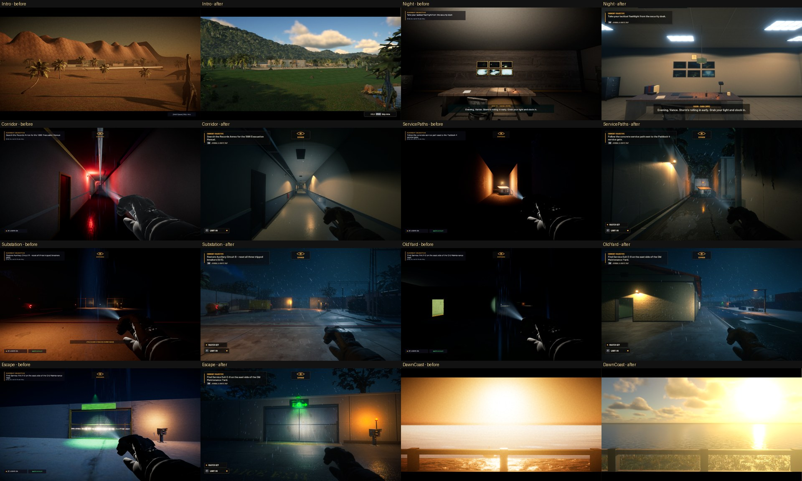
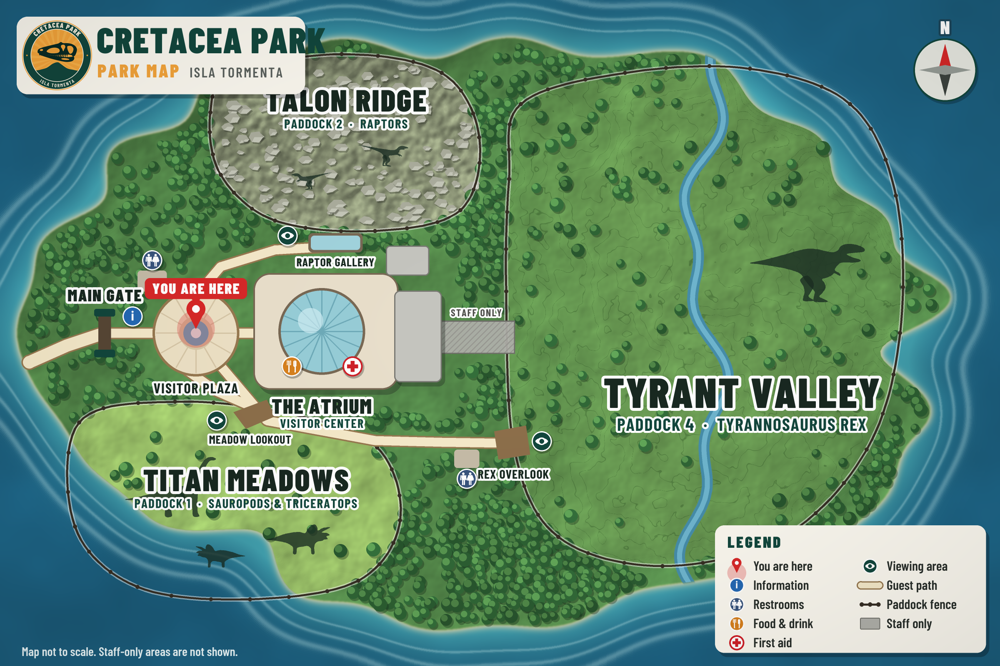

# Cretacea: Blackout (Unity)

A first-person survival-horror game made in Unity 6 with HDRP. You are the night caretaker at Cretacea Park, a dinosaur
theme park on a stormy island. A midnight power switchover fails, the park blacks out, the paddock gates fail open and
every normal exit is sealed. The only way out is an old staff exit, E-0, and it needs auxiliary power that you have to
restore by hand at Substation 3, in the middle of the T. rex paddock. You have a flashlight, tall grass to hide in, and
raptors that notice light and movement.

This is the Unity version. The game was first made in Godot; that version lives in its own repository:
[Cretacea-Blackout-Godot](https://github.com/jc-able/Cretacea-Blackout-Godot).

## Screenshots



*The same eight views before (left of each pair: the first Unity port) and after (right) the first day of the look pass,
Nov 20 2026. The game was improved further after this sheet was made.*



*The park map you carry on your tablet.*

## How this was made

Almost all of this project was written by AI coding agents, directed by the YouTube creator JC in plain English.

- **Nov 18-19, 2026:** the original game was built in Godot 4.7.2 by Claude Opus 5.5 in Claude Code.
- **Nov 19-20:** Gemini 4 Neon, working in Antigravity, ported it to Unity 6 with HDRP (the first Unity build).
- **Nov 20-21:** Claude (Fable 5.2, then Opus 5.5 after Fable hit its usage limit) did the look pass: lighting,
  materials, terrain, weather, the flashlight, the held hand, creature motion, the menus, story fixes and a bot that
  plays the game. The work ran in rounds: several agents each built one package, an AI critic reviewed it, and four
  full reviews by teams of AI critics scored the whole game (their reports are in `docs/review1` to `docs/review4`).

Every prompt, decision, number and before/after picture is in the devlog, in the Godot repository:
[docs/devlog](https://github.com/jc-able/Cretacea-Blackout-Godot/tree/main/docs/devlog) (the Unity port is chapter 7).

## Requirements

- **Unity 6000.6.9f1 exactly.** Install it through Unity Hub (Installs > Install Editor; older versions are under the
  Archive tab). The project uses HDRP 17.6, which belongs to this Unity release. Opening it in another version makes
  Unity upgrade or downgrade the project, and HDRP settings and the large binary scene files may not survive that.
  Nobody has tested another version.
- **Operating system:** it was built and tested only on macOS with Apple Silicon (Metal). Windows (DirectX 12) and
  Linux (Vulkan) are supported by HDRP and should work, but nobody has tried them yet. Add the Build Support module
  for each platform you want to build for.
- **Disk space:** the project is about 3.7 GB. Unity's first import creates a large `Library` folder, and a macOS build
  is about 2.6 GB, so keep roughly 20 GB free.
- **A decent GPU:** HDRP is demanding (volumetric fog, rain, many lights). It was measured on an Apple M5 Max at
  64-120 fps at 1920x1080. On a weaker machine, lower the quality setting in the game's Settings.

## Get the code

```bash
git clone https://github.com/jc-able/Cretacea-Blackout-Unity.git
```

Or press **Code > Download ZIP** on GitHub and unzip it. The repository is large (about 3.7 GB; the world scene alone
is 78 MB), so either way takes a while. Everything the game needs is in the repository: no Git LFS, no extra downloads.

## Open and play

1. In Unity Hub, choose **Add > Add project from disk** and pick the folder you cloned or unzipped.
2. Open it with Unity 6000.6.9f1. The first import takes a long time (anything from several minutes to an hour,
   depending on your machine) while Unity imports the art and compiles HDRP shaders. Let it finish.
3. Open `Assets/Scenes/MainMenu.unity` and press **Play**. Choose **NEW GAME** (the opening cinematic plays first) or
   **CHAPTER SELECT** to start at any chapter. The scenes and every generated helper file (terrain tiles, tree LODs and
   impostors, the hill jungle, the grass textures) are already in the repository, so there is nothing to rebuild first.
4. To skip the menu while testing, open `Assets/Scenes/MainWorld.unity` and press Play: it starts at Chapter 1.

Your save and settings are written to `cretacea_save.json` and `cretacea_settings.json` in Unity's persistent data
folder (on macOS `~/Library/Application Support/DefaultCompany/CretaceaBlackoutUnity`, on Windows
`%USERPROFILE%\AppData\LocalLow\DefaultCompany\CretaceaBlackoutUnity`). Playing in the editor uses the same files as a
build. To keep a test run away from your real save, set the environment variable `CRETACEA_SAVE_DIR` to another folder.

## Controls

Defined in code in `Assets/Scripts/Core/CretaceaInput.cs`. Gamepad buttons use Xbox names; other gamepads work with the
buttons in the same places.

| Action | Keyboard and mouse | Gamepad |
|---|---|---|
| Move | W A S D or arrow keys | Left stick |
| Look | Mouse | Right stick |
| Sprint (uses stamina) | Left Shift (hold) | LB (hold), or click the left stick to keep sprinting |
| Crouch (toggle) | C or Left Ctrl | B |
| Flashlight on/off | F | Y |
| Interact (hold for some actions) | E | X |
| Tablet: objective and map | Tab | View |
| Pause | Esc | Menu |
| Skip a cutscene | Space (hold) | X (hold) |
| Close a document / back | Esc | B |
| Menus | Mouse, or arrows + Enter, Esc to go back | D-pad or left stick, A to select, B to go back |

Settings has mouse and gamepad sensitivity, invert Y, field of view, brightness, subtitles and sound captions, volumes,
vibration and a quality level. The pause menu also has a CONTROLS page.

## The story and how to finish

The objective at the top left always tells you where to go next; Tab shows it again with a map. The game saves a
checkpoint at the start of each chapter, and RETRY CHECKPOINT puts you back there when you die.

1. **Night Shift:** take your flashlight from the security desk, clock in, and log the paddock feeds in the Control
   Room. When the power fails, try the main entrance in the Lobby, then the Staff Exit.
2. **Records Annex:** find the 1996 Evacuation Manual at the east end of the Staff Corridor. It tells you the way out.
3. **Service Paths:** go through Feed Prep to the Loading Dock (crouch to crawl under the jammed door), follow the
   concrete service path east, and crouch under the jammed Paddock 4 gate.
4. **Tyrant Valley:** cross the valley to Substation 3.
5. **Substation 3:** reset the three tripped breakers, prime the generator's fuel pump (hold), start the generator and
   throw the transfer lever (hold). Then run, following the green route lights east.
6. **Old Maintenance Yard:** find Service Exit E-0 and hold OPEN until it is up. If you have to hide, your progress on
   the gate is kept. Then get out and follow the coast road.

Tips: crouching in tall grass with the flashlight off hides you. Predators notice light, movement and noise, and you
cannot fight them. Documents found along the way fill in the story; the Evacuation Manual is the only one you must
find.

## Project layout

```
Assets/
  Scripts/        game code, one folder per assembly: Core, Player, AI, Story, Interact, UI, Audio, Rendering, Dev
  Editor/         editor-only code: WorldBuilder (builds the scenes), LookPass (lighting and materials), importers
  Scenes/         MainMenu.unity and MainWorld.unity (both generated by Build All Scenes; do not hand-edit)
  Art/            models, textures, terrain, dinosaurs, visitors, UI images (signs, documents, maps)
  Prefabs/        dinosaurs, characters, props, interactables, the player and foliage
  Animations/     dinosaur and player animation controllers
  Audio/          ambience, music, sound effects, voice lines and the audio mixer
  Resources/      assets loaded at runtime: the five atmosphere profiles, the sound bank, UI images
  Settings/       HDRP quality assets (Performant, Balanced, High Fidelity) and render settings
  Shaders/        custom shaders: ocean, rain, wet surfaces, CCTV screens
  VFX/            the storm rain system and sparks
Packages/         the Unity package list
ProjectSettings/  Unity project settings (the build scene list is in EditorBuildSettings.asset)
Tools/lookdev/    test and capture scripts the agents used (Python 3 and shell)
docs/             the look bible, the hand-off notes, agent briefs and hand-ins, and four AI review rounds
```

## Keep building it

**Where the code lives.** All gameplay code is in `Assets/Scripts`. Each folder except `Dev` is its own assembly
(`.asmdef`), so a change in one folder recompiles quickly.

**How the main systems fit together.**
- `Core/GameState.cs` holds the run: the current checkpoint, story flags and the objective text. `SaveManager.cs` writes
  it to JSON. `GameEvents.cs` is a static event hub that the other systems talk through.
- `Story/StoryDirector.cs` runs the story. It reacts to trigger volumes (`Core/StoryTriggerVolume.cs`) and to things the
  player uses, sets objectives, saves checkpoints and spawns dinosaurs. Start here to change what happens and when.
- `Player/` has movement, stamina and crouching (`PlayerController.cs`), the flashlight, interaction, the held hand's
  motion (`ViewmodelMotion.cs`) and cutscene cameras (`CameraDirector.cs`).
- `AI/` has the dinosaurs: `RaptorAI.cs`, `TrexAI.cs` and `HerbivoreAI.cs` share `DinoControllerBase.cs`;
  `DinoSpawner.cs` places them; `ParkVisitorCrowd.cs` is the opening's crowd.
- `Interact/` has doors, documents, the flashlight pickup, the substation controls and hold-to-use objects.
- `UI/` builds every menu and HUD element in code (`CretaceaUiFactory.cs`, `MenuController.cs`, `HudController.cs`,
  `JournalController.cs` for the tablet).
- `Core/AtmosphereController.cs` blends the five atmosphere presets (day, dusk, calm night, storm blackout, dawn) and
  drives sun, moon, lightning, rain and wetness; `Rendering/` has the weather, wetness and foliage helpers.
- `Audio/SoundBank.cs` maps sound cue names to the clips in `Assets/Audio`; `AudioManager.cs` plays them.

**The scenes are generated by code.** `Assets/Editor/WorldBuilder` holds one builder per zone (visitor center, service
paths, substation and yard, terrain, jungle and coast) plus `CretaceaWorldAssembler.cs`, which puts both scenes
together, bakes the dinosaur navigation meshes and registers the scenes for builds. `Assets/Editor/LookPass` then sets
render settings, atmosphere profiles, materials, lights and weather. The committed scenes are the output of these
builders. To change the level, change a builder and run Build All Scenes again: anything you edit by hand in
`MainWorld.unity` or `MainMenu.unity` is lost the next time the scenes are rebuilt. Stop Play mode first. A rebuild
takes a few minutes, rewrites the generated helper files (terrain tiles, foliage LODs and impostors, grass atlases) and
ends with a report in the Console.

Useful menu items (all under **Cretacea** in the editor's menu bar):
- **World > Build All Scenes (MainWorld + MainMenu):** rebuild both scenes from the builders.
- **World > Verify Doors, Flashlight & Documents:** in Play mode, checks every door's clearance, the five documents and
  both navigation meshes.
- **Look > Run Look Pass On Open Scene**, **Look > Regenerate Atmosphere Profiles**, **Look > Place Weather (puddles,
  mist, sparks)**
- **Dinosaurs > Build Dinosaur Prefabs & Animators**, **PBR > Pack All HDRP MaskMaps (Assets/Art & Assets/Textures)**,
  **UI > Build Font Assets**

**The command-line bridge (optional).** `Packages/manifest.json` includes `com.unity.pipeline`, Unity's command-line
bridge: it lets a terminal tool called `unity` talk to the open editor. The AI agents used it to rebuild scenes, take
screenshots and play-test without a mouse, for example `unity command cretacea build_all_scenes`. The editor scripts use
its attributes, so leave the package installed (Unity downloads it for you). You do not need the `unity` tool itself to
open, play, change or build the game, and players of a built game never need any of it.

**Test tools.** `Tools/lookdev` needs Python 3 (with Pillow and numpy for the image tools), the `unity` command-line
tool on your PATH and an open editor. Set `UNITY_PROJECT_PATH` to your project folder first: the scripts otherwise fall
back to a folder name from the original machine.
- `route_test.py` plays every story beat in Play mode through the game's own triggers, checks the game state after
  each one (45 checks) and saves a screenshot per beat.
- `playthrough.py` starts the playthrough bot (`Assets/Scripts/Dev/PlaythroughBot.cs`), which plays the whole game with
  real input on foot, and saves frames whenever it gets stuck or dies. Add `--menu` to start from NEW GAME.
- `capture_set.sh`, `motion_set.sh`, `perf.sh` and `frame_stats.py` take review screenshots and measure frame rate and
  brightness. The scripts in `Tools/lookdev/lead` are kept as a record; their paths need changing before reuse.

**Docs that help.** `docs/LOOK_BIBLE.md` explains the lighting rules, the measured light values and how the project is
built. `docs/HANDOFF.md` is the agents' running log, with every fix, measurement and trap they hit. `docs/review1`
to `docs/review4` are the critics' reports, `docs/briefs` the instructions each agent got and `docs/handin` what each one
delivered. Some of these notes mention folders on the original machine (agent clones, scratch folders); those do not
exist for you.

**Making a build.** Open **File > Build Profiles**, pick your platform and press **Build**.
MainMenu and MainWorld are already in the scene list. To check a build without playing it, start it with
`-cretaceaSmoke <folder>`: it opens the menu, visits every chapter start, writes a screenshot per stop and a
`report.txt` with frame rates and errors into that folder, then quits (`Assets/Scripts/Dev/SmokeTestRunner.cs`). On
macOS:

```bash
CRETACEA_SAVE_DIR=/tmp/cretacea-save "YourBuild.app/Contents/MacOS/CretaceaBlackoutUnity" -cretaceaSmoke /tmp/cretacea-smoke
```

## Known limitations

- Tested only on macOS with Apple Silicon. Windows and Linux are untested.
- The first launch of a new build compiles shaders, which causes a stall of several seconds in the menu and again when
  the world loads. Later launches are smooth.
- From the air at dusk, the far hill's trees show a mosaic pattern (it needs a proper impostor shader). Dawn meadow
  trees are slightly brown and the tall grass is a little too saturated.
- The held hand's fingers do not move (it is a single scanned model), and the T. rex roar pose is weak.
- Some rooms (the break room, the gift shop) are still sparsely dressed, and the first room of the game is evenly lit.
- The playthrough bot cannot open some closed doors on its own, so no single bot run has gone from NEW GAME to the end.
  A bot run from the Records Annex checkpoint did finish the game; a player opens those doors with E.
- The scenes are binary files, so Git cannot show what changed inside them. Change the builders instead.
- `docs/review4` lists the remaining smaller issues.

## License

The original work in this repository (code, scenes, docs and the art and audio made for this project) is dedicated to
the public domain under [CC0 1.0](LICENSE): use it for anything, no credit required. Third-party content keeps its own
license; see [CREDITS.md](CREDITS.md). The VARCO Sound editor plugin (a commercial Asset Store tool used during
development) is not included; the game does not need it, and every sound it plays is in `Assets/Audio`.
